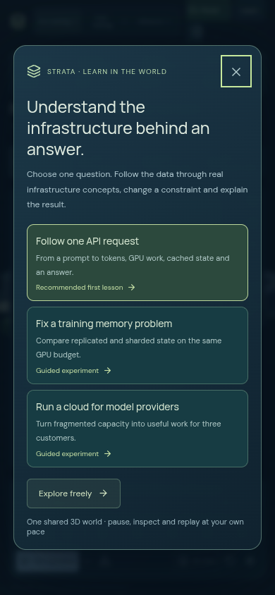
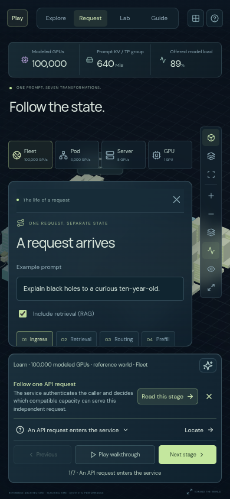
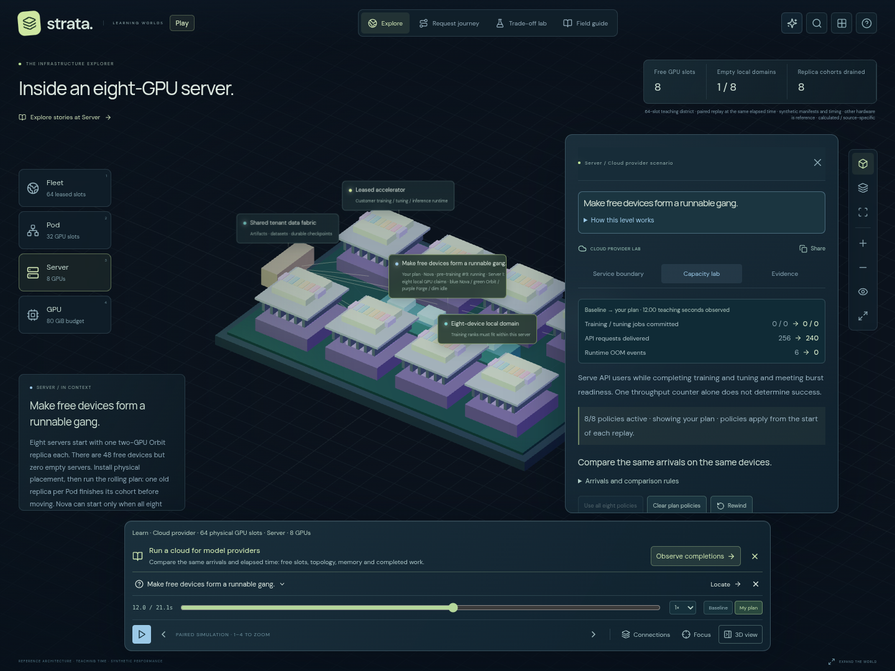
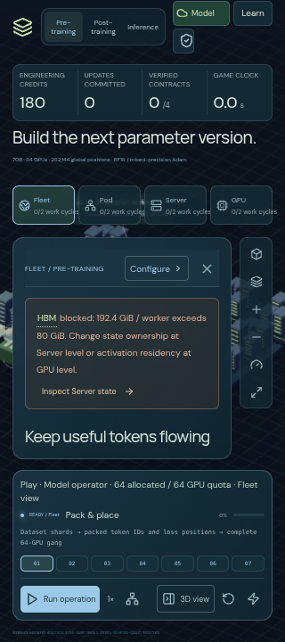
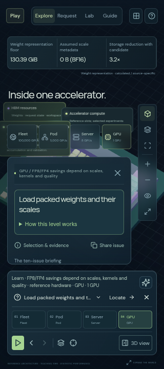
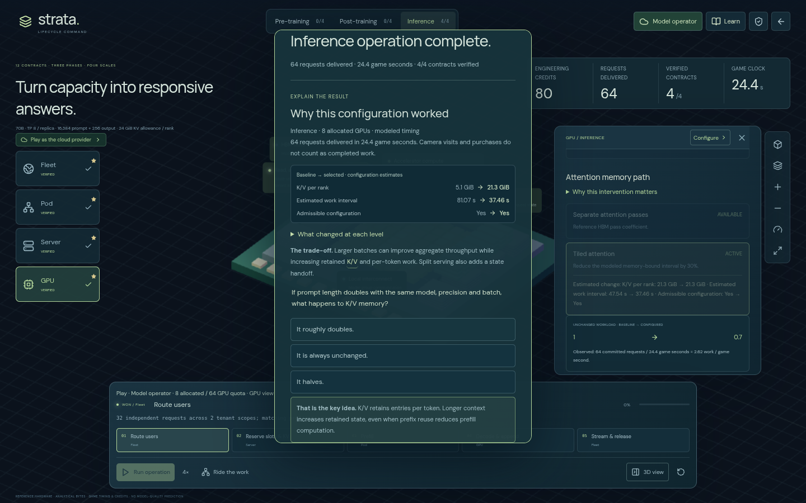
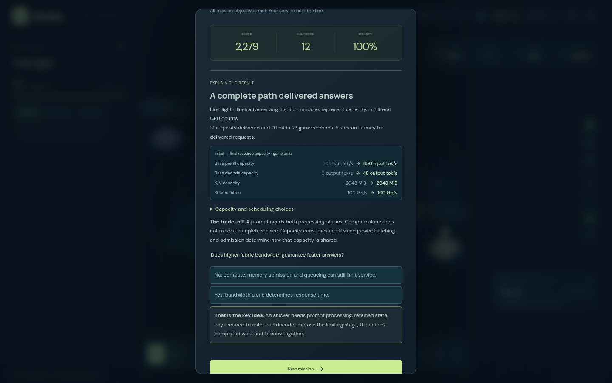

# Learner experience improvements

Implemented after the November 6, 2026 learner-perspective review. The review used real Chromium and screenshot inspection; it was an expert walkthrough, not a study with recruited participants.

| Review finding                                     | Implemented behavior                                                                                                                                                                                                                                                                                                                                         |
| -------------------------------------------------- | ------------------------------------------------------------------------------------------------------------------------------------------------------------------------------------------------------------------------------------------------------------------------------------------------------------------------------------------------------------ |
| No beginner starting task                          | First-visit chooser recommends following one API request, with training memory and physical Cloud operations as alternatives. Every path has a visible learning goal. Explore freely, returning visitors and explicit destination links retain direct access. Help in both modes reopens the paths.                                                          |
| Competing and buried request players               | A persistent Previous / Play / Next bar drives both the request stage and its existing animation. The generic timeline and narration player are removed from this journey. Cinema and Space use the same walkthrough state. Optional retrieval changes the stage count.                                                                                      |
| Policy edits lost the comparison moment            | Cloud edits preserve time, pause and show the plan. The cursor clamps only if the new history ends earlier. Policies apply from each history's start; live allocations still wait for actual cohort/recovery boundaries. Explicit Rewind remains available.                                                                                                  |
| Estimates looked like completed work               | Lifecycle rates are labeled estimates and a blocked configuration states that it cannot commit work. Completed work and game time remain observed counters. Game interventions and lab strategy changes show calculated before/after values. Cloud comparisons explicitly cover API work, training/tuning commitment, failures and burst readiness together. |
| Moving parcels lacked an immediate explanation     | A flow coach sits with the current controls. It explains payload, direction, purpose, physical blocks, aggregated parcels and scope, and can focus the subject in the existing world. HBM, KV, prefill, decode, embedding, ZeRO, gangs and other terms have native popover explanations. Colocated serving keeps K/V local; split serving can transfer it.   |
| Modes and hardware scopes were hard to distinguish | Visible Learn/Play and role labels; text workspace labels on phones. Persistent scope names the reference fleet, sized lifecycle job or 64-slot Cloud district and the current physical view. No claim that illustrative districts are a real deployed cluster.                                                                                              |
| Completion emphasized rewards over transfer        | Request, training sizing and Cloud lessons, plus lifecycle, Cloud and serving-district game outcomes, include an explanation, actual selected policies, outcome, trade-off and reflection question. Reflection never awards a physical contract or claims improved model quality.                                                                            |

The training path deliberately teaches **model state ownership**: replicated state versus ZeRO-3 under an illustrative 80 GiB per-device budget. Its recap states that activations and workspace require additional room and no training update was executed. The game separately checks its complete modeled resident memory before committing work.

The request lesson follows a split prefill/decode reference path, including the state handoff. It explicitly explains that colocated serving can keep state local. Flow explanations and help pause playback for reading; Escape returns to the same scene. Starting a guided path exits fullscreen and preserves the paused game.

The Cloud path starts at the fragmentation problem, paused at 12 teaching seconds with baseline policies. It guides one placement change, a complete plan at the same moment, then actual simulated completions. All eight policies remain available for independent experiments in the Capacity lab. One physical-scale rail controls the Cloud viewpoints, without repeating that navigation as a second four-step bar. A lower API count at one instant is not presented as an automatic failure or success.

## Verification

Pure tests check first-visit routing, immutable policy edits and horizon clamping, calculated admission feedback, observed paired Cloud counters, and the difference between sizing, walkthroughs and executed work. Browser checks use native controls and actual WebGL, including narrow phones and landscape, flow explanations, focus, before/after comparisons and reflections. The existing game and connected-story regressions remain in place.

Validation on November 6, 2026:

- **133 unit tests passed**, including five new checks of entry routing, comparison time, admission feedback and recap truthfulness.
- **93 distinct Chromium browser cases verified** across the complete 92-case sweep and affected-case reruns, plus the new phone-navigation regression. The first sweep found seven assertion/layout failures; the focused correction run passed 13 of 14 cases, and the final layout matrix passed all six, covering the remaining failure. Rendering, game rules and unchanged story workflows retain their successful full-sweep results.
- **10 production-path journeys passed** against the built site under `/AI-Infra/`, including all three lessons, phone/landscape controls, glossary/flow explanations, visible reflection feedback, fullscreen handoffs and retained games.
- Additional production checks completed actual inference, Cloud and serving-game victories, verified reflection feedback in view, inspected phone camera/reader bounds, and exercised fresh entry. These checks recorded no page errors, console errors or failed asset responses.
- Formatting, strict TypeScript and the GitHub Pages production build passed.

Both Learning and Game reserve the measured dock height. Narrow phone game navigation keeps Learn and the selected role visible. Context camera controls fit above the dock; glossary terms stay in the sentence, and opening an explanation pauses its playback. Quiz feedback scrolls into view without camera motion.

Human learning outcomes, screen-reader use and non-Chromium devices are not measured by these checks.

## Browser evidence

Unmodified screenshots from the production build, using the application's native controls and actual WebGL. The world and its data are educational schematics, not measurements of deployed model hardware.

First-visit goals and the persistent request controls:

Matched-time Cloud results and primary game navigation:

Hardware controls and completed-work recaps:

