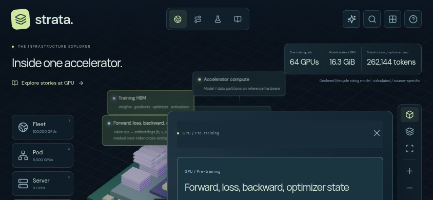
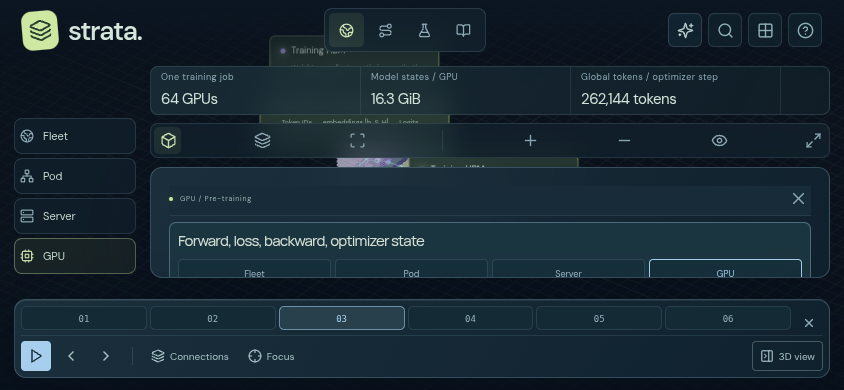
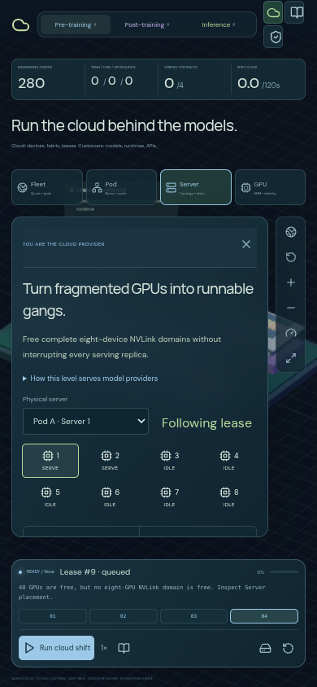
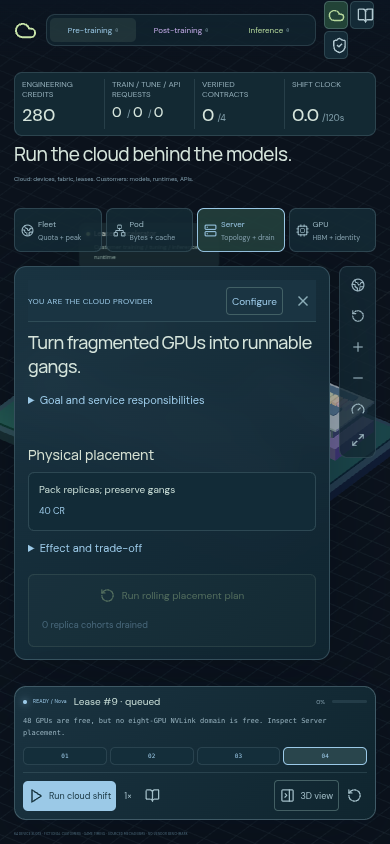
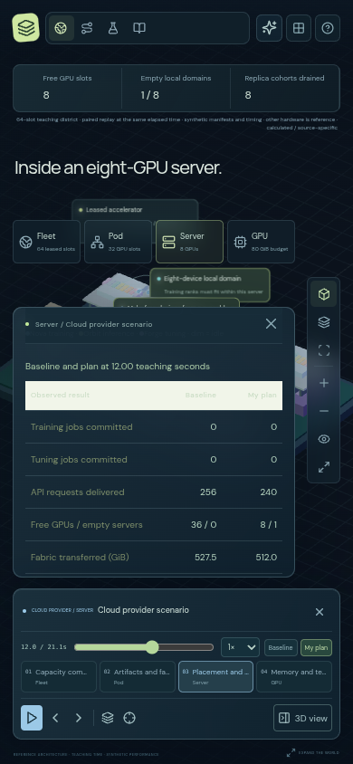
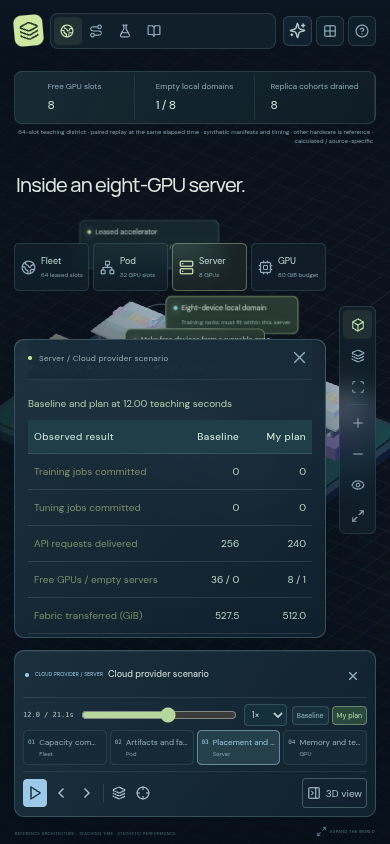

# Browser and visual review

Reviewed November 6, 2026, using installed Chromium 155, Playwright and actual Three.js/WebGL rendering. Screenshots were inspected visually at full size and in contact sheets. Browser interactions used the application's native controls, raycasting tests and touch events.

## Coverage

| Area                   | Workflows reviewed                                                                                                                                                        |
| ---------------------- | ------------------------------------------------------------------------------------------------------------------------------------------------------------------------- |
| Lifecycle game         | Pre-training, SFT, DPO, GRPO and inference; Fleet, Pod, Server and GPU; configuration, admission failures, completed work, contracts, recovery, retained runs and sources |
| Cloud game             | All four physical levels; quotas, fabric/cache, physical placement, rolling recovery, memory envelopes, lease isolation, tenant inspection and actual shift completion    |
| Serving district       | Mission briefing, construction, upgrades, live requests, operations, sandbox, Fusion and Tactical layouts                                                                 |
| Learning               | Explore, Request journey, Trade-off lab, Field guide, search, missions, sharing, camera controls and mode round trips                                                     |
| Connected stories      | All six real models, all ten hot issues, all three lifecycle phases and the Cloud provider lesson; all four scales, experiments, evidence and playback                    |
| Alternative conditions | Reduced motion, missing WebGL, paused rendering, responsive resize, keyboard controls and touch orbiting                                                                  |

The visual matrix uses 1440×900 desktop, 1366×768 laptop, 834×1112 tablet, 390×844 phone, 320×568 small phone, 844×390 landscape and 720×450 compact viewports. Fresh phone entry and an already-open desktop inspector resized to phone are checked separately. They intentionally have different initial inspector states.

## Findings and changes

| Priority | Observed problem                                                                                                                           | Implemented improvement                                                                                                                                                                                 |
| -------- | ------------------------------------------------------------------------------------------------------------------------------------------ | ------------------------------------------------------------------------------------------------------------------------------------------------------------------------------------------------------- |
| P1       | Learning retained a 740 px minimum height in a 390 px landscape viewport. Playback and story controls could sit below the visible browser. | Fit the world to the viewport and give every Learning workspace a compact layout. Keep scale, camera and playback controls reachable in both orientations.                                              |
| P1       | Open inspectors and generic Learning panels covered the phone's scale/camera controls. Long story docks could crowd the reader.            | Pin narrow-screen inspectors below the navigation, preserve the camera rail, and measure the playback dock with `ResizeObserver` to reserve its actual height.                                          |
| P2       | Cloud Game showed server selectors, an eight-device map and a tenant ledger before its first purchasable policy.                           | Put policies first. Keep physical inspection and its ledger in an expandable section. Put the rolling-plan action directly beside the placement policy.                                                 |
| P2       | The memory warning navigated to a level but left the relevant choice below the fold, including when already at that level.                 | Scroll to and focus the state-ownership or K/V-representation decision. Add a visible Configure shortcut to both game workshops. Navigation never buys a policy or starts work.                         |
| P2       | Long, repeated perspective explanations consumed the connected reader before model selectors, lifecycle methods or lesson tabs appeared.   | Keep the heading and physical-level navigation visible, with the full explanation in a native expandable disclosure. Compact Cloud comparison guidance and put lab strategies before optional missions. |
| P2       | Tiny telemetry labels and an icon-only “World” toggle made controls difficult to interpret on phones.                                      | Enlarge key telemetry, costs and metric labels. Keep a visible **3D view / Details** or **3D view / Controls** toggle with panel icons and expanded state.                                              |
| P2       | Landscape Game stacked its header, score, level rail, camera, workshop and dock into almost no usable workshop height.                     | Use a side rail and a wider workshop in landscape. Compact headers scroll away so a complete decision can be brought into view.                                                                         |
| P2       | Enlarged telemetry overlapped the camera rail in landscape; desktop reader padding consumed most of the remaining height.                  | Measure the telemetry height, position the camera and reader below it, compact their headers, and use the available reader width. Hidden narration is removed while a phone reader is open.             |
| P2       | Cloud table headers inherited the classic layout’s light background while retaining pale text.                                             | Use explicit dark header backgrounds, readable type and wrapping for Cloud comparison and responsibility tables. A browser regression verifies at least 4.5:1 text contrast.                            |
| P1       | The 2D fallback retained centered desktop positioning and could put hardware controls behind the HUD or playback dock.                     | Bound the fallback to the same reserved workspace and put its hardware controls first in landscape.                                                                                                     |

Expanded explanations, sources, accounting and allocation inspection remain available. Hardware topology, quantitative models, simulation costs and clock semantics are preserved.

## Screenshot evidence

The following are unmodified screenshots from the browser at matching viewport sizes and routes.

### Learning in phone landscape

Before: a viewport-height mismatch clips the world and loses the bottom controls.

After: the scene, scales, camera rail, scrollable reader and playback dock fit the viewport.

### Cloud Game on a phone

Before: inspection widgets consume the workshop before any policy appears.

After: physical placement, its price and the rolling-plan action are discoverable in the workshop.

### Cloud comparison table

Before: pale labels on a light inherited header.

After: readable column labels on an explicit dark background.

## Regression checks

`tests/usability.spec.ts` adds nine browser checks for the observed problems:

- Policy discovery and actual installation at every Cloud Game level on laptop and phone.
- Memory-warning navigation that focuses the real setting without spending credits or running work.
- Phone reader controls, expandable explanations and reversible 3D-view toggles.
- All four Learning workspaces and connected stories in compact orientations, including hit testing for the scale and camera controls.
- Readable Cloud table headers and hardware controls in the 2D fallback.
- Short-screen Game configuration and playback access.
- Actual Chromium touch gestures that change the 3D camera and retain the lesson when the reader is reopened.

Run the complete browser suite with `npm run test:e2e`. It includes the existing rendering, lifecycle, model, hot-issue, cloud and serving-game tests as well as these regressions. Run `npm test` for the simulation and algorithm tests, and `npm run build -- --base /AI-Infra/` to validate the production project-path bundle.

Validation results:

- Complete Chromium regression: **81 passed** in 17.4 minutes.
- Simulation and algorithm tests: **128 passed**.
- Formatting and strict TypeScript production build with `/AI-Infra/`: passed.
- Visual matrix: **100 before and 100 after captures**, including touch/orientation cases; no page errors or horizontal page overflow in that matrix. Targeted landscape measurements additionally verify that telemetry, camera and reader bounds do not overlap.

Production-path regression after the spacing and table changes: **8 passed**, using the built site at `/AI-Infra/`, including actual touch input and landscape telemetry/reader visibility. After bounding the fallback, its component-inspection regression and the table-contrast check both passed (**2 passed**). These runs cover all nine distinct usability regressions. The two later visual findings brought that review’s suite to 83 cases. Subsequent guided-entry, comparison, explanation and recap improvements are recorded in [Learner experience improvements](LEARNER-EXPERIENCE.md), with their additional browser coverage.

The additional production review captured **44 views** of dialogs, experiments, tables, completed lifecycle/cloud games and fallback interfaces, with no page errors or horizontal overflow in the completed captures. One initial Cloud victory capture exceeded a 12-second navigation budget; a fresh browser with the normal navigation allowance completed the actual winning strategy.

## Scope of the result

This review covers every shipped mode and story family, with representative responsive states and the existing deeper end-to-end workflows. It does not exhaust every combination of workload inputs. Chromium uses software WebGL in this environment; phone gestures are real browser touch events under device emulation. Safari, Firefox, physical mobile GPUs, screen-reader usability and representative human learning outcomes require separate evaluation. No device-performance benchmark or accessibility certification is implied.
